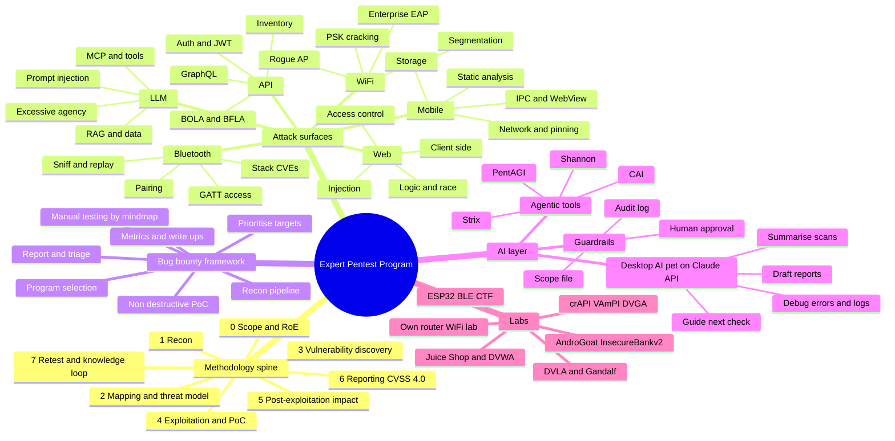

# Master Mindmap — Expert Pentest & Bug Bounty Program

Six attack surfaces, one methodology spine, one bug bounty framework, one AI companion.
Each domain file holds its own mindmap (methodology phase → vulnerability) and a
25-row check table with the tools and GitHub projects embedded per check.

| Domain | File | Primary standard |
|---|---|---|
| Web application | [01-web.md](01-web.md) | OWASP Top 10 (2021/2025), OWASP WSTG |
| API (REST / GraphQL / gRPC) | [02-api.md](02-api.md) | OWASP API Security Top 10 (2023) |
| Wi-Fi | [03-wifi.md](03-wifi.md) | IEEE 802.11 / WPA2 / WPA3, NIST SP 800-153 |
| Bluetooth (Classic + BLE) | [04-bluetooth.md](04-bluetooth.md) | Bluetooth Core Spec, NIST SP 800-121 |
| LLM / AI agents | [05-llm.md](05-llm.md) | OWASP Top 10 for LLM Apps (2025), MITRE ATLAS |
| Mobile / APK | [06-mobile.md](06-mobile.md) | OWASP MASVS / MASTG, Mobile Top 10 (2024) |

## Severity and reporting convention (all domains)

- Score with **CVSS 4.0**; add business impact in one sentence.
- Every finding: ID (e.g. `W-04`), affected asset, steps to reproduce, evidence, impact, fix, references.
- Status flow in the tracker: `todo → lab-tested → live-tested → reported → triaged → resolved / dup / n/a`.
