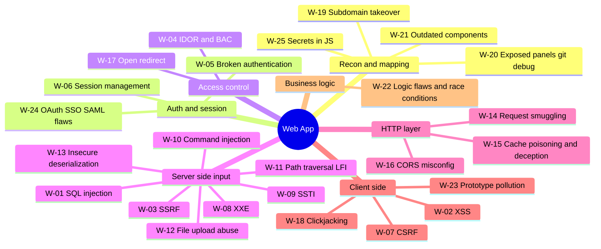

# Web Application — Top 25 Checks

Standards: OWASP Top 10:2025, OWASP WSTG v4.2, PortSwigger Web Security Academy.
AI assist: **Strix** (dynamic, PoC-validated), **Shannon** (white-box when source is available), Burp AI extensions.

| ID | Phase | Vulnerability | What to check | Tools / GitHub projects | Ref |
|---|---|---|---|---|---|
| W-01 | Server-side input | SQL injection | Error/boolean/time/OOB SQLi in params, headers, JSON bodies, ORDER BY | sqlmap, ghauri, Burp Scanner | A05:2025, WSTG-INPV-05 |
| W-02 | Client-side | XSS (reflected/stored/DOM) | Sink/source tracing, CSP bypass, mXSS, DOM clobbering | dalfox, XSStrike, Burp DOM Invader | A05:2025, WSTG-CLNT-01 |
| W-03 | Server-side input | SSRF | URL fetchers, webhooks, PDF renderers → cloud metadata (169.254.169.254), internal ports | interactsh, Burp Collaborator, SSRFmap | A01:2025 (SSRF folded in) |
| W-04 | Access control | IDOR / broken access control | Swap object IDs across two accounts, vertical priv-esc, forced browsing | Burp Autorize, AuthMatrix | A01:2025 |
| W-05 | Auth & session | Broken authentication | Credential stuffing defences, MFA bypass, reset-token entropy, user enum | Burp Intruder, hydra | A07:2025 |
| W-06 | Auth & session | Session management | Fixation, cookie flags, logout invalidation, token predictability | Burp Sequencer | WSTG-SESS |
| W-07 | Client-side | CSRF | State-changing requests w/o token, SameSite gaps, JSON CSRF | Burp CSRF PoC generator | WSTG-SESS-05 |
| W-08 | Server-side input | XXE | XML/SVG/DOCX uploads, SOAP, content-type switch to XML, blind OOB | Burp, XXEinjector, interactsh | A02:2025 |
| W-09 | Server-side input | SSTI | Template expressions in names/emails/templates; engine fingerprint | SSTImap, tplmap | WSTG-INPV-18 |
| W-10 | Server-side input | OS command injection | Filenames, ping/diag features, blind time/OOB | commix, interactsh | A05:2025 |
| W-11 | Server-side input | Path traversal / LFI / RFI | Encoded `../`, null bytes, wrappers (php://), log poisoning | ffuf + LFI wordlists, dotdotpwn | WSTG-ATHZ-01 |
| W-12 | Server-side input | Unrestricted file upload | Extension/MIME/magic-byte bypass, polyglots, stored XSS via SVG, path control | fuxploider, Burp Upload Scanner | WSTG-BUSL-09 |
| W-13 | Server-side input | Insecure deserialization | Java/.NET/PHP/Python serialized blobs, ViewState, pickles | ysoserial, ysoserial.net, PHPGGC | A08:2025 |
| W-14 | HTTP layer | HTTP request smuggling | CL.TE / TE.CL / H2 downgrade desync | Burp HTTP Request Smuggler, smuggler.py | PortSwigger research |
| W-15 | HTTP layer | Web cache poisoning / deception | Unkeyed headers, path confusion, static-extension deception | Burp Param Miner | PortSwigger research |
| W-16 | HTTP layer | CORS misconfiguration | Reflected Origin + credentials, null origin, regex bypass | Corsy, Burp | A02:2025 |
| W-17 | Access control | Open redirect | `next=`/`return=` params; chain to OAuth token theft | OpenRedireX, Burp | WSTG-CLNT-04 |
| W-18 | Client-side | Clickjacking | Missing frame-ancestors / X-Frame-Options on sensitive actions | Burp Clickbandit | WSTG-CLNT-09 |
| W-19 | Recon | Subdomain takeover | Dangling CNAMEs to S3/Azure/GitHub Pages/Heroku | subfinder + dnsx, subzy, nuclei takeover templates | can-i-take-over-xyz |
| W-20 | Recon | Exposed panels / .git / debug | Admin panels, `.git`, `.env`, actuator, phpinfo, Swagger | nuclei, ffuf, git-dumper | A02:2025 |
| W-21 | Recon | Vulnerable & outdated components | Version fingerprint → known CVEs / KEV | httpx -tech-detect, nuclei CVE templates, retire.js | A03:2025 Supply Chain |
| W-22 | Business logic | Logic flaws & race conditions | Coupon/balance races, workflow skips, negative values, limit bypass | Burp Turbo Intruder (single-packet attack) | WSTG-BUSL |
| W-23 | Client-side | Prototype pollution | Client & server-side PP → XSS / RCE gadgets | Burp DOM Invader, ppmap | PortSwigger research |
| W-24 | Auth & session | OAuth / OIDC / SAML flaws | redirect_uri bypass, state/PKCE missing, signature wrapping, XSW | Burp SAML Raider, Burp OAuth tests | WSTG-ATHZ-05 |
| W-25 | Recon | Secrets & endpoints in JS | API keys, hidden endpoints, source maps | jsluice, LinkFinder, trufflehog | A04:2025 |

**OWASP Top 10:2025 mapping:** A01 Broken Access Control (now incl. SSRF) · A02 Security Misconfiguration · A03 Software Supply Chain Failures · A04 Cryptographic Failures · A05 Injection · A06 Insecure Design · A07 Authentication Failures · A08 Software or Data Integrity Failures · A09 Logging & Alerting Failures · A10 Mishandling of Exceptional Conditions. A04–A09 order taken from secondary sources — confirm on owasp.org/Top10.
