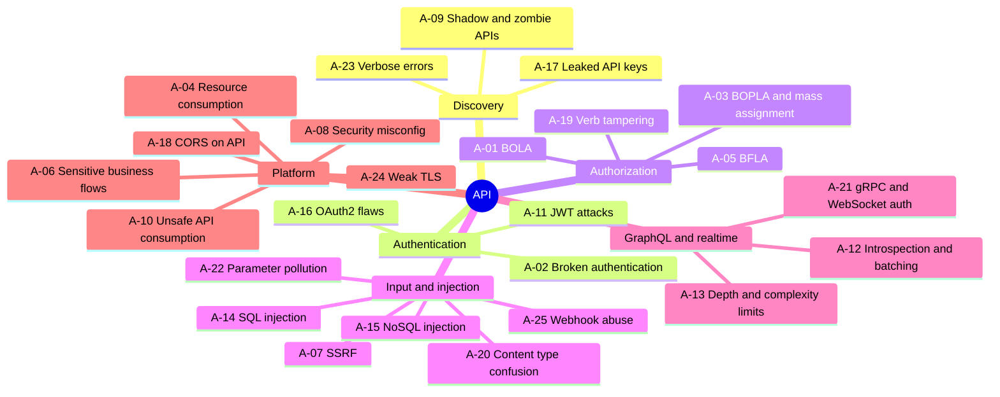

# API (REST / GraphQL / gRPC / WebSocket) — Top 25 Checks

Standards: OWASP API Security Top 10 (2023), OWASP WSTG API testing, OWASP GraphQL Cheat Sheet.
AI assist: **Strix**, **PentAGI** (multi-step auth flows), Claude for OpenAPI-spec threat modelling.

| ID | Phase | Vulnerability | What to check | Tools / GitHub projects | Ref |
|---|---|---|---|---|---|
| A-01 | Authorization | BOLA | Swap object IDs (UUIDs too) between two tenants/users on every endpoint | Burp Autorize, Postman, Akto | API1:2023 |
| A-02 | Authentication | Broken authentication | Token in URL, no lockout, weak reset, missing auth on some routes | Burp, Postman, Akto | API2:2023 |
| A-03 | Authorization | BOPLA / mass assignment / excessive data | Extra props in response; write `role`, `isAdmin`, `price` | Arjun, Burp Param Miner | API3:2023 |
| A-04 | Platform | Unrestricted resource consumption | Rate limits, pagination caps, upload size — **test gently** | Burp Intruder (throttled), ffuf -rate | API4:2023 |
| A-05 | Authorization | BFLA | Call admin functions as low-priv user; method swap | Burp Autorize, kiterunner | API5:2023 |
| A-06 | Platform | Sensitive business flows | Bot-able purchase/signup/referral flows w/o anti-automation | Burp Turbo Intruder | API6:2023 |
| A-07 | Input | SSRF | URL params, import-from-URL, webhooks → metadata/internal | interactsh, SSRFmap | API7:2023 |
| A-08 | Platform | Security misconfiguration | Debug endpoints, default creds, missing headers, open Swagger | nuclei, Schemathesis | API8:2023 |
| A-09 | Discovery | Improper inventory (shadow/zombie) | `/v1` vs `/v3`, staging hosts, undocumented routes | kiterunner, ffuf, gau, katana | API9:2023 |
| A-10 | Platform | Unsafe consumption of 3rd-party APIs | Trust of upstream data, redirects, TLS to partners | Manual + Burp | API10:2023 |
| A-11 | Authentication | JWT attacks | alg=none, RS→HS confusion, weak secret, kid/jku injection, expiry | jwt_tool, hashcat (-m 16500) | RFC 8725 |
| A-12 | GraphQL | Introspection & batching | Introspection on, field suggestions, alias/batch brute force | graphw00f, InQL, clairvoyance | OWASP GraphQL CS |
| A-13 | GraphQL | Depth / complexity limits | Nested query cost limits — **prove with small depth, never DoS** | InQL, GraphQL Cop | OWASP GraphQL CS |
| A-14 | Input | SQL injection in API params | JSON/XML bodies, filters, sort params | sqlmap (`-r` request file), ghauri | API8 / A03 |
| A-15 | Input | NoSQL injection | `$ne`, `$gt`, `$regex` operators in JSON | NoSQLMap, Burp | WSTG-INPV-05.6 |
| A-16 | Authentication | OAuth2 / OIDC flaws | redirect_uri, PKCE, scope escalation, token leakage, client creds exposure | Burp, oauth-tester checklists | RFC 9700 |
| A-17 | Discovery | Leaked API keys & secrets | Keys in mobile apps, JS, GitHub, Postman public workspaces | trufflehog, gitleaks, apkleaks | API2 |
| A-18 | Platform | CORS on API | Reflected origin with credentials on authenticated APIs | Corsy | API8 |
| A-19 | Authorization | HTTP verb tampering / method override | `X-HTTP-Method-Override`, HEAD/OPTIONS bypass | Burp, ffuf -X | WSTG-CONF-06 |
| A-20 | Input | Content-type confusion | JSON→XML (XXE), form vs JSON parser differentials | Burp Content Type Converter | API8 |
| A-21 | Realtime | gRPC / WebSocket auth gaps | Per-message auth, CSWSH, reflection enabled on gRPC | grpcurl, Burp WebSockets | WSTG-CLNT-10 |
| A-22 | Input | HTTP parameter pollution | Duplicate params / JSON keys parsed differently by gateway vs app | Burp, Arjun | WSTG-INPV-04 |
| A-23 | Discovery | Verbose errors / stack traces | Stack traces, SQL errors, internal hostnames in error bodies | Burp, Schemathesis fuzzing | API8 |
| A-24 | Platform | Weak / missing TLS | Protocol/cipher downgrade, HSTS, cert validation | testssl.sh, sslyze | API8 |
| A-25 | Input | Webhook abuse | Missing signature validation, replay, SSRF via callback URL | Burp, interactsh, RESTler / Schemathesis for spec-driven fuzzing | API7 / API10 |

**Spec-driven fuzzing:** Schemathesis and Microsoft RESTler consume OpenAPI specs to auto-generate stateful test cases — run these first on every in-scope spec.
