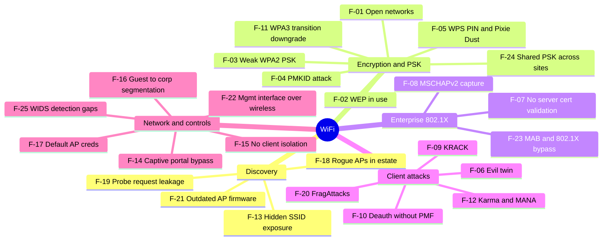

# Wi-Fi — Top 25 Checks

Standards: IEEE 802.11i/w, WPA2/WPA3 (SAE), NIST SP 800-153, PCI DSS 11.2 (rogue AP detection).
**Only test networks you own or are explicitly authorised in writing to test.** Deauth/jamming is illegal in many jurisdictions outside an approved, controlled window.
Hardware: monitor-mode + injection adapter (e.g. Alfa AWUS036ACH / ACM), optional second adapter for evil-twin, optional WiFi Pineapple.
AI assist: none autonomous — use the AI pet to interpret captures, pick hashcat modes, and debug driver/monitor-mode issues.

| ID | Phase | Vulnerability | What to check | Tools / GitHub projects | Ref |
|---|---|---|---|---|---|
| F-01 | Encryption | Open / unencrypted networks | Corporate data over open SSIDs, no OWE | airodump-ng, Kismet | SP 800-153 |
| F-02 | Encryption | WEP in use | Legacy devices still on WEP | aircrack-ng | Deprecated |
| F-03 | Encryption | Weak WPA2-PSK passphrase | 4-way handshake capture → offline crack | hcxdumptool, hcxpcapngtool, hashcat (-m 22000), wifite2 | 802.11i |
| F-04 | Encryption | PMKID attack | Clientless PMKID from RSN IE | hcxdumptool, hashcat (-m 22000) | hashcat research |
| F-05 | Encryption | WPS PIN / Pixie Dust | WPS enabled, offline Pixie Dust | reaver, bully, wash | CVE class |
| F-06 | Client attacks | Evil twin / rogue AP | Clients auto-join spoofed SSID | eaphammer, hostapd-mana, wifiphisher, airgeddon | MITRE T1557 |
| F-07 | Enterprise | No RADIUS server cert validation | Supplicants accept any cert → creds | eaphammer | SP 800-153 |
| F-08 | Enterprise | EAP-MSCHAPv2 credential capture | NetNTLM challenge/response → crack | eaphammer, asleap, hashcat (-m 5500) | — |
| F-09 | Client attacks | KRACK (key reinstallation) | Client/AP patch state | krackattacks-scripts (vanhoefm) | CVE-2017-13077+ |
| F-10 | Client attacks | Deauth susceptibility (no PMF) | 802.11w not required — **test only in approved window** | aireplay-ng, bettercap | 802.11w |
| F-11 | Encryption | WPA3 transition-mode downgrade (Dragonblood) | WPA3/WPA2 mixed mode → downgrade; SAE side channels | dragonslayer / dragondrain (vanhoefm), hostapd-mana | Dragonblood paper |
| F-12 | Client attacks | Karma / MANA probe responses | Clients joining any SSID they probe for | hostapd-mana, eaphammer | — |
| F-13 | Discovery | Hidden SSID | Treated as a control when it isn't | airodump-ng, Kismet | — |
| F-14 | Network | Captive portal bypass | MAC/IP spoofing of authenticated clients, DNS tunnelling | macchanger, iodine (lab) | — |
| F-15 | Network | Client isolation missing | Client-to-client reachability on guest/corp WLAN | nmap, bettercap | — |
| F-16 | Network | Guest → corporate segmentation | Reach internal ranges / mgmt VLANs from guest | nmap, naabu | PCI DSS 1.x |
| F-17 | Network | Default creds on AP / controller | Web/SSH/SNMP defaults | nuclei default-login templates, hydra | — |
| F-18 | Discovery | Rogue APs inside the estate | Unauthorised APs bridged to wired LAN | Kismet, airodump-ng | PCI DSS 11.2.1 |
| F-19 | Discovery | Probe request leakage | Clients broadcasting PNL (privacy, evil-twin seeding) | Kismet, bettercap | — |
| F-20 | Client attacks | FragAttacks | Fragmentation/aggregation design + impl flaws | fragattacks (vanhoefm) | CVE-2020-24586+ |
| F-21 | Discovery | Outdated AP firmware | Vendor CVEs on controllers / APs | nmap -sV, nuclei, vendor advisories | — |
| F-22 | Network | Management interface over wireless | Admin UI/SSH reachable from WLAN side | nmap | CIS |
| F-23 | Enterprise | MAB / 802.1X bypass | MAC-auth-bypass spoofing, hub/bridge tricks on wired-side APs | macchanger, silentbridge (lab) | — |
| F-24 | Encryption | Shared PSK across sites / no rotation | Same PSK everywhere; ex-staff knowledge | Interview + config review | — |
| F-25 | Network | WIDS/WIPS detection gaps | Do your attacks get detected and alerted? | Purple-team: run F-06/F-10 and check SIEM | — |
