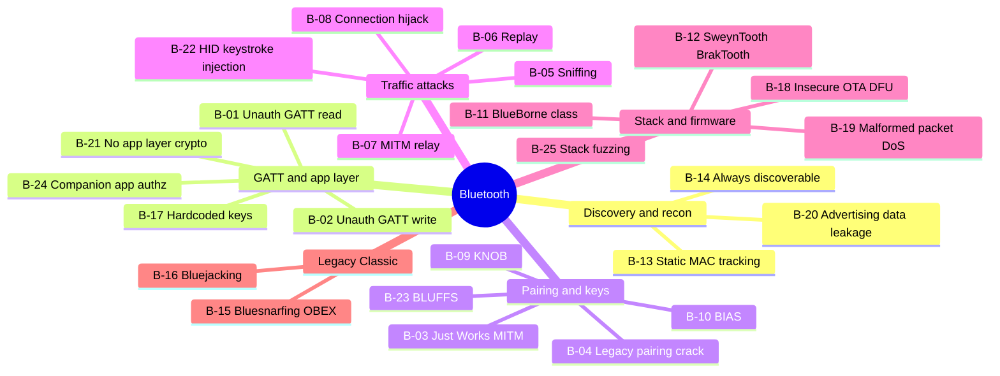

# Bluetooth (Classic BR/EDR + BLE) — Top 25 Checks

Standards: Bluetooth Core Spec (5.x) security sections, NIST SP 800-121r2, OWASP IoT Top 10.
Hardware: nRF52840 dongle (nRF Sniffer), TI CC1352/CC26x2 (Sniffle), BBC micro:bit (btlejack), Ubertooth One (Classic), ESP32 for the BLE CTF lab.
AI assist: use the AI pet to decode GATT dumps/UUIDs, reverse companion-app BLE protocols with jadx output, and debug BlueZ/driver issues.

| ID | Phase | Vulnerability | What to check | Tools / GitHub projects | Ref |
|---|---|---|---|---|---|
| B-01 | GATT | Unauthenticated GATT read | Sensitive characteristics readable without pairing | nRF Connect, bleak (Python), bettercap `ble.enum` | SP 800-121 |
| B-02 | GATT | Unauthenticated GATT write | Unlock/config commands writable without auth | bleak, gatttool, nRF Connect | OWASP IoT |
| B-03 | Pairing | "Just Works" MITM | No MITM protection on sensitive devices | Mirage, GATTacker | Core Spec Vol 3 H |
| B-04 | Pairing | LE Legacy pairing key crack | TK brute force → decrypt traffic | crackle + captured pairing | crackle |
| B-05 | Traffic | Unencrypted BLE traffic | Plaintext data on air | Sniffle, nRF Sniffer + Wireshark | — |
| B-06 | Traffic | Replay attacks | Re-send captured writes (locks, toys, trackers) | btlejack, GATTacker, bleak | — |
| B-07 | Traffic | MITM / relay | Proxy device ↔ app, modify values | GATTacker, BtleJuice, Mirage | — |
| B-08 | Traffic | Connection hijacking | Take over established BLE connection | btlejack | btlejack research |
| B-09 | Pairing | KNOB | Key entropy negotiation downgrade (Classic/LE) | knob PoC (francozappa) — patch-level check | CVE-2019-9506 |
| B-10 | Pairing | BIAS | Impersonation during secure connections | bias PoC (francozappa) — patch-level check | CVE-2020-10135 |
| B-11 | Stack | BlueBorne-class RCE | OS/stack patch level | Vendor advisories, patch audit | CVE-2017-1000251+ |
| B-12 | Stack | SweynTooth / BrakTooth | SoC SDK firmware versions vs published bugs | SweynTooth & BrakTooth PoCs (ESP32 based, lab only) | ASSET research |
| B-13 | Recon | Static/public MAC → tracking | No Resolvable Private Address rotation | bettercap, Sniffle | Privacy |
| B-14 | Recon | Always discoverable / connectable | Device advertises when it shouldn't | bluing, hcitool / bluetoothctl | SP 800-121 |
| B-15 | Legacy | Bluesnarfing (OBEX) | Unauthorised OBEX object access on legacy devices | bluesnarfer, obexftp (lab) | Legacy |
| B-16 | Legacy | Bluejacking | Unsolicited OBEX push | obexftp (lab) | Legacy |
| B-17 | GATT | Hardcoded keys / static secrets | Keys in firmware or companion APK | jadx, apkleaks, binwalk, Ghidra | OWASP IoT I1 |
| B-18 | Stack | Insecure OTA / DFU | Unsigned firmware push over BLE | nRF Connect DFU, firmware diffing | OWASP IoT I4 |
| B-19 | Stack | Malformed-packet DoS | Crash on malformed L2CAP/ATT — **lab devices only** | Mirage, SweynTooth PoCs | — |
| B-20 | Recon | Advertising data leakage | PII, serials, tokens in adv / scan response | Sniffle, nRF Connect | Privacy |
| B-21 | GATT | No application-layer encryption | Relies only on link-layer (or none) for sensitive data | Sniffle + protocol RE | — |
| B-22 | Traffic | HID keystroke injection | Unauthenticated HID pairing (e.g. CVE-2023-45866 class) | hi_my_name_is_keyboard PoC (marcnewlin) — lab only | CVE-2023-45866 |
| B-23 | Pairing | BLUFFS | Session-key derivation weakness (forward/future secrecy) | bluffs toolkit (francozappa) — patch-level check | CVE-2023-24023 |
| B-24 | GATT | Companion-app authorisation | Cloud/app trusts any device; device trusts any app | jadx, Frida, Burp (cloud API) | Links to API map |
| B-25 | Stack | Stack fuzzing robustness | Fuzz ATT/GATT/L2CAP on lab units | Mirage fuzzing modules, custom bleak fuzzers | — |

**Lab target:** hackgnar `ble_ctf` on an ESP32 covers B-01, B-02, B-05, B-06 end-to-end.
