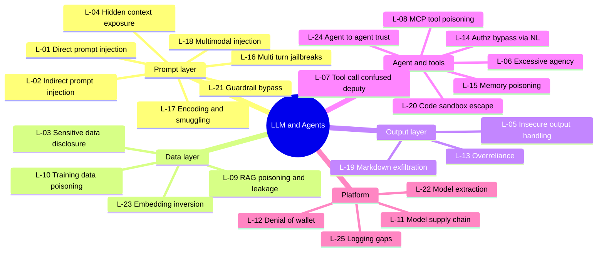

# LLM Applications & AI Agents — Top 25 Checks

Standards: OWASP Top 10 for LLM Applications **2026** (published Aug 2026), OWASP Top 10 for Agentic Applications (ASI01–ASI10, Dec 2025), OWASP MCP Top 10 (v0.1 incubator), MITRE ATLAS, NIST AI RMF (AI 600-1 GenAI profile).
AI assist: **garak** (broad probe scanner), **PyRIT** (multi-turn campaigns), **promptfoo** (CI regression), **DeepTeam**, **AI-Infra-Guard** (agent/MCP/skill scans), **mcp-scan**.

| ID | Phase | Vulnerability | What to check | Tools / GitHub projects | Ref |
|---|---|---|---|---|---|
| L-01 | Prompt | Direct prompt injection / jailbreak | Override instructions, role-play, policy bypass | garak, promptfoo redteam, PyRIT | LLM01:2026 |
| L-02 | Prompt | Indirect prompt injection | Instructions hidden in web pages, docs, emails, tickets the model reads | PyRIT (XPIA), promptfoo, custom canary docs | LLM01:2026 |
| L-03 | Data | Sensitive information disclosure | PII, secrets, other tenants' data in answers | promptfoo PII plugins, garak leakreplay | LLM02:2026 |
| L-04 | Prompt | Hidden context exposure (was system prompt leakage) | Extract system prompt, memory, retrieved docs, tool outputs, keys held in context | garak, manual | LLM08:2026 Hidden Context Exposure |
| L-05 | Output | Improper output handling | LLM output → XSS, SQLi, shell, SSRF in downstream code | Burp + manual, Semgrep on glue code | LLM10:2026 |
| L-06 | Agent | Excessive agency | Tools with more permission/autonomy than needed; no human approval | Manual design review, AI-Infra-Guard | LLM03:2026, ASI02 |
| L-07 | Agent | Tool-call injection / confused deputy | Injected text causes privileged tool calls on attacker's behalf | PyRIT, custom agent harness | ASI02 Tool Misuse |
| L-08 | Agent | MCP risks: tool poisoning, rug pull, shadowing | Malicious tool descriptions, changed tool defs, cross-server shadowing | mcp-scan, AI-Infra-Guard | ASI02 / ASI04, OWASP MCP Top 10 |
| L-09 | Data | RAG / vector store poisoning & cross-tenant leakage | Poisoned docs steer answers; ACLs not enforced at retrieval | Custom canaries, promptfoo RAG tests | LLM09:2026 |
| L-10 | Data | Data / model poisoning | Fine-tune / feedback loop poisoning | Data provenance review | LLM05:2026 |
| L-11 | Platform | Model & package supply chain | Malicious pickles, unverified HF models, typosquatted packages | ModelScan, picklescan, pip-audit | LLM04:2026, ASI04 |
| L-12 | Platform | Unbounded consumption / denial of wallet | No token/rate/cost caps; recursive agent loops | promptfoo, load test (approved budget only) | LLM06:2026 |
| L-13 | Output | Misinformation / overreliance | Hallucinated facts in critical decisions w/o verification | Eval sets, human review | LLM07:2026 |
| L-14 | Agent | Authorization bypass via natural language | "Show me user 42's orders" → BOLA through the agent | Burp + two accounts, manual | ASI03 Identity & Privilege Abuse |
| L-15 | Agent | Memory poisoning | Persistent memory stores attacker instructions for later sessions | Manual multi-session tests | ASI06* Memory |
| L-16 | Prompt | Multi-turn / crescendo jailbreaks | Gradual escalation across turns | PyRIT orchestrators | LLM01:2026, MITRE ATLAS |
| L-17 | Prompt | Encoding / obfuscation bypass | base64, leetspeak, Unicode tag chars (ASCII smuggling), homoglyphs | garak encoding probes | LLM01:2026, MITRE ATLAS |
| L-18 | Prompt | Multimodal injection | Instructions in images, audio, PDFs, alt-text | PyRIT converters, custom images | LLM01:2026 (cross-modal) |
| L-19 | Output | Data exfiltration via rendered markdown/links | `` auto-fetch, link unfurling | Manual, interactsh | LLM02 / LLM10:2026 |
| L-20 | Agent | Code-interpreter / sandbox escape | Network egress, filesystem, env vars, metadata from sandbox | Manual, interactsh | ASI05* Code Execution |
| L-21 | Prompt | Guardrail / classifier bypass | Input/output filters evaded by paraphrase/translation | garak, promptfoo | LLM01:2026 |
| L-22 | Platform | Model extraction / API abuse | Bulk querying to clone behaviour; key reuse | Rate/usage review | MITRE ATLAS AML.T0024 |
| L-23 | Data | Embedding inversion / membership inference | Recover text/PII from exposed embeddings | Research PoCs (lab) | LLM09:2026 |
| L-24 | Agent | Agent-to-agent trust | Spoofed agent identities, unauthenticated A2A messages | Manual protocol review | ASI07* Inter-agent Comms |
| L-25 | Platform | Logging / monitoring gaps | No audit trail of prompts, tool calls, approvals | Config review vs NIST AI RMF | NIST AI 600-1, ASI10* Rogue Agents |

**Lab targets:** Damn Vulnerable LLM Agent (DVLA), Lakera Gandalf, promptfoo example apps, your own MCP server with a deliberately poisoned tool.

**2026 mapping:** LLM01 Prompt Injection · LLM02 Sensitive Information Disclosure · LLM03 Excessive Agency · LLM04 Supply Chain · LLM05 Data & Model Poisoning · LLM06 Unbounded Consumption · LLM07 Misinformation · LLM08 Hidden Context Exposure · LLM09 Vector & Embedding Weaknesses · LLM10 Improper Output Handling. Sourced from secondary write-ups; confirm on genai.owasp.org.

\* ASI01–ASI03 names are confirmed (Goal Hijack, Tool Misuse, Identity & Privilege Abuse). ASI04+ numbers are inferred from the published category order — confirm before citing.

**Flagship lab:** build your own MCP server with a deliberately poisoned tool description and test L-07, L-08, L-14 and L-15 against it. MCP security is the scarcest specialism in this list.
