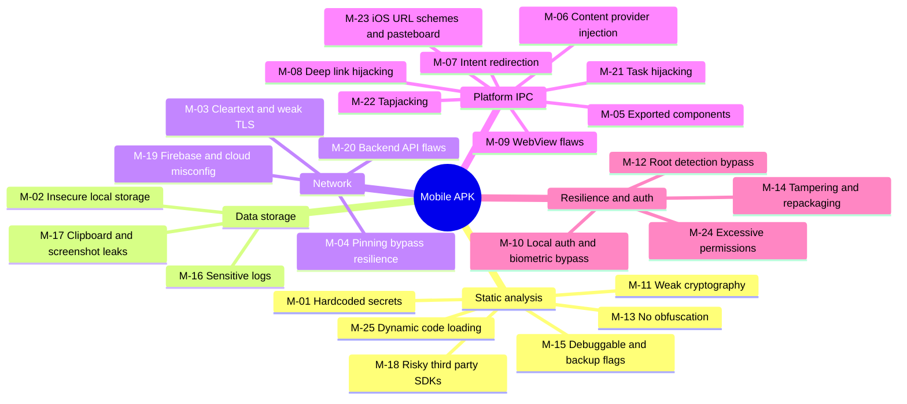

# Mobile / APK (Android-first, iOS where noted) — Top 25 Checks

Standards: OWASP MASVS v2 + MASTG, OWASP Mobile Top 10 (2024).
Lab: rooted Android emulator (Android Studio AVD / Genymotion), physical rooted test device, jailbroken iOS test device if iOS is in scope.
AI assist: **MobSF** for the static/dynamic baseline, then Claude (via the AI pet) to review jadx-decompiled hot spots, write Frida hooks, and debug tooling.

| ID | Phase | Vulnerability | What to check | Tools / GitHub projects | Ref |
|---|---|---|---|---|---|
| M-01 | Static | Hardcoded secrets / API keys | Keys, tokens, endpoints in code/resources/native libs | MobSF, apkleaks, jadx, trufflehog | M1:2024 |
| M-02 | Storage | Insecure data storage | SharedPrefs, SQLite, Realm, files, iOS Keychain/NSUserDefaults | objection, adb, MobSF | M9:2024 |
| M-03 | Network | Cleartext / weak TLS | `usesCleartextTraffic`, network_security_config, custom TrustManagers | MobSF, Burp, mitmproxy | M5:2024 |
| M-04 | Network | Certificate pinning resilience | Can pinning be trivially bypassed? Is it present at all? | Frida, objection `android sslpinning disable` | MASVS-NETWORK |
| M-05 | IPC | Exported activities/services/receivers | Exported w/o permission → auth bypass, data access | drozer, MobSF, adb `am start` | M8:2024 |
| M-06 | IPC | Content provider SQLi / traversal | Exported providers, `openFile` traversal | drozer | MASVS-PLATFORM |
| M-07 | IPC | Intent redirection / implicit intent hijack | Forwarded intents, PendingIntent mutability | drozer, jadx review | MASVS-PLATFORM |
| M-08 | IPC | Deep link / App Link hijacking | Unverified links, token in deep link, open redirect into WebView | adb, jadx, Burp | M4:2024 |
| M-09 | IPC | WebView misconfiguration | JS + `addJavascriptInterface`, file access, universal access from file URLs | jadx, Frida, Burp | MASVS-PLATFORM |
| M-10 | Auth | Insecure local auth / biometric bypass | Biometric not bound to crypto (CryptoObject), PIN checks client-side | Frida, objection | M3:2024 |
| M-11 | Static | Insufficient cryptography | ECB, static IVs, hardcoded keys, MD5/SHA1 for passwords | MobSF, jadx, Frida crypto hooks | M10:2024 |
| M-12 | Resilience | Root / jailbreak detection bypass | Strength of detection (only relevant if required by threat model) | Frida, objection, Magisk DenyList | MASVS-RESILIENCE |
| M-13 | Static | Lack of obfuscation / easy RE | Readable business logic, secrets in clear | jadx, apktool, Ghidra (native) | M7:2024 |
| M-14 | Resilience | Tampering / repackaging | No integrity / signature checks; Play Integrity not enforced server-side | apktool rebuild + apksigner | M7:2024 |
| M-15 | Static | Debuggable / allowBackup | `android:debuggable`, `allowBackup`, data-extraction rules | MobSF, adb backup | MASVS-CODE |
| M-16 | Storage | Sensitive data in logs | Tokens/PII in logcat / os_log | adb logcat, pidcat | M6:2024 |
| M-17 | Storage | Clipboard / keyboard / screenshot leakage | FLAG_SECURE missing, autocomplete on secrets, app-switcher snapshots | Manual, adb | MASVS-PRIVACY |
| M-18 | Static | Insecure third-party SDKs | Vulnerable / over-privileged SDKs, trackers | MobSF, Exodus Privacy, dependency SCA | M2:2024 |
| M-19 | Network | Firebase / cloud backend misconfig | Open Firebase RTDB/Firestore/Storage, public S3 buckets, exposed keys | firebase scanners, nuclei cloud templates | M8:2024 |
| M-20 | Network | Backend API flaws | Run the full API map against the app's backend | See [02-api.md](02-api.md) | API Top 10 |
| M-21 | IPC | Task hijacking (StrandHogg-class) | `taskAffinity` / `launchMode` abuse | Manual PoC app, MobSF | MASVS-PLATFORM |
| M-22 | IPC | Tapjacking / overlay attacks | `filterTouchesWhenObscured` missing on sensitive views | Manual PoC app | MASVS-PLATFORM |
| M-23 | IPC (iOS) | URL scheme hijacking / pasteboard leakage | Custom schemes w/o validation, sensitive data on UIPasteboard | Frida, objection (iOS) | MASVS-PLATFORM |
| M-24 | Resilience | Excessive permissions / privacy | Permissions beyond function, background location, tracking | MobSF, Exodus Privacy | M6:2024 |
| M-25 | Static | Dynamic code loading / insecure update | DexClassLoader from writable paths, unsigned hot-patch | jadx, Frida | MASVS-CODE |

**Lab targets:** OWASP MASTG UnCrackable apps, AndroGoat, InsecureBankv2, DIVA, InjuredAndroid; iOS: DVIA-v2.
