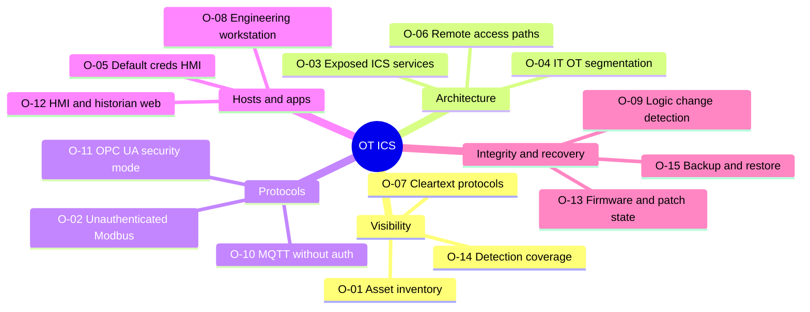

# OT / ICS — 15 Core Checks (lab only)

Standards: IEC 62443-3-3 (zones & conduits, SR/RE), NIST SP 800-82r3, MITRE ATT&CK for ICS, CISA ICS advisories + KEV.
Scoring: CVSS 4.0 with the **Safety (S)** supplemental metric for anything that could affect a physical process.

> **Safety rule:** active testing is done **only against simulators and lab PLCs you own**. On any real plant, work is passive (traffic capture, config and document review) unless the asset owner approves a written test plan with operations staff present. Never write to a live controller.

Lab: OpenPLC runtime (soft PLC), GRFICSv3 (3D process sim), ScadaBR or FUXA (HMI), Mosquitto (MQTT), an OPC UA demo server, MODLURE / Conpot (honeypots), CISA Malcolm or Zeek + Suricata for detection. Optional: Raspberry Pi as a "field device".
AI assist: the companion explains protocol captures, maps findings to IEC 62443 requirements, and drafts the OT risk narrative.

| ID | Phase | Weakness | What to check | Tools / projects | Ref |
|---|---|---|---|---|---|
| O-01 | Visibility | Incomplete asset inventory | Passive discovery of PLCs/HMIs/protocols from a SPAN port | Malcolm, Zeek ICS parsers, Wireshark | 62443 SR 7.8, 800-82 |
| O-02 | Protocols | Unauthenticated Modbus/TCP | Lab PLC accepts reads/writes from any host on the segment | pymodbus, Wireshark (lab only) | ATT&CK ICS T0855 |
| O-03 | Architecture | ICS services reachable from IT or internet | Exposure of 502/20000/102/4840/1883 from outside the OT zone | Firewall rule review, Shodan for **your own** ranges | 62443 SR 5.1 |
| O-04 | Architecture | Weak IT/OT segmentation | Zones & conduits, DMZ, flat networks, dual-homed hosts | Config review, traceroute from IT zone (lab) | 62443-3-2 zones/conduits |
| O-05 | Hosts | Default credentials on HMI / PLC web UI | Vendor defaults on engineering and HMI interfaces | Lab OpenPLC/ScadaBR, vendor docs | 62443 SR 1.1 |
| O-06 | Architecture | Insecure remote access | Vendor VPNs, shared accounts, no MFA, always-on access | Design + config review | 62443 SR 1.13, CISA guidance |
| O-07 | Visibility | Cleartext protocols | Modbus, DNP3 without SAv5, S7 without protection on the wire | Wireshark, Zeek (passive) | 62443 SR 4.1 |
| O-08 | Hosts | Engineering workstation hardening | Patch state, local admin, USB policy, AV/EDR, project file access | CIS benchmarks, config review | ATT&CK ICS T0847 |
| O-09 | Integrity | No logic change detection | Can PLC program changes happen without alert or approval? | Lab PLC + Malcolm alerting | 62443 SR 3.4 |
| O-10 | Protocols | MQTT broker without auth/TLS | Anonymous subscribe/publish, wildcard topics | mosquitto_sub, MQTT Explorer (lab) | 62443 SR 1.2 |
| O-11 | Protocols | OPC UA security mode None / anonymous | SecurityPolicy None, anonymous login, cert trust lists | asyncua client, UaExpert (lab) | 62443 SR 1.2, 4.1 |
| O-12 | Hosts | HMI / historian web flaws | Run the web checklist against HMI and historian web apps | See [01-web.md](01-web.md) | 62443 SR 3.5 |
| O-13 | Integrity | Firmware & patch state | Versions vs CISA ICS advisories and KEV; signed firmware? | Inventory + advisories | CISA ICSA, KEV |
| O-14 | Visibility | Detection gaps | Do lab write/stop commands raise alerts in Malcolm/Suricata? | Purple team: run O-02 in lab, check alerts | ATT&CK ICS detections |
| O-15 | Integrity | Backup & restore | Offline backups of PLC logic/configs; tested restore time | Restore drill in lab | 62443 SR 7.3, 800-82 |

**Capstone case study:** "From IT foothold to OT zone in a lab: what segmentation stopped, what it didn't, and what the SOC saw" — maps every step to IEC 62443 requirements and ATT&CK for ICS.
